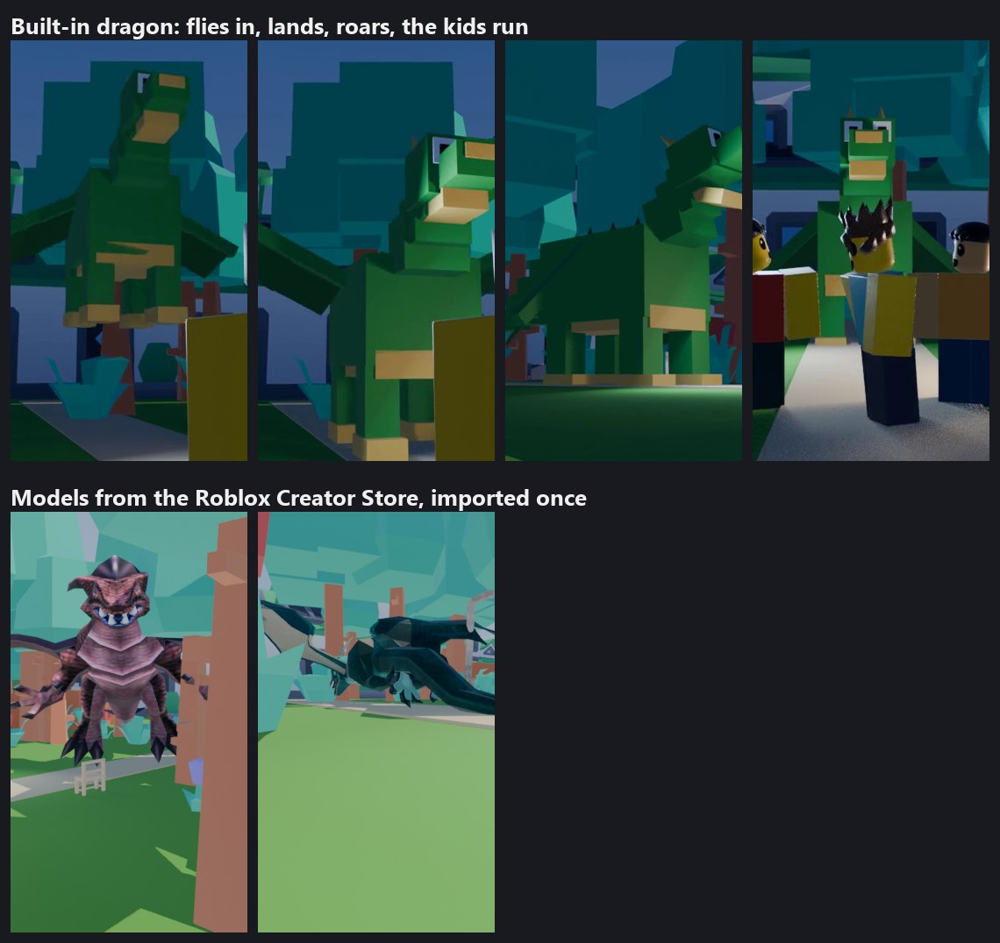
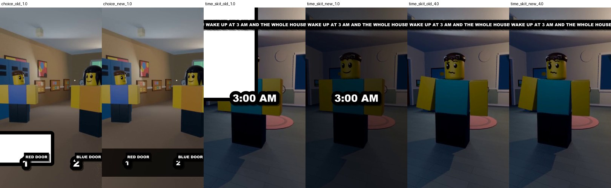
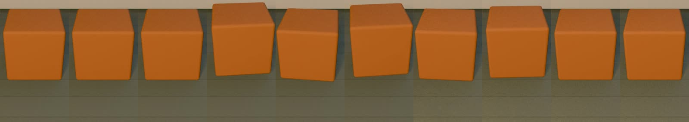
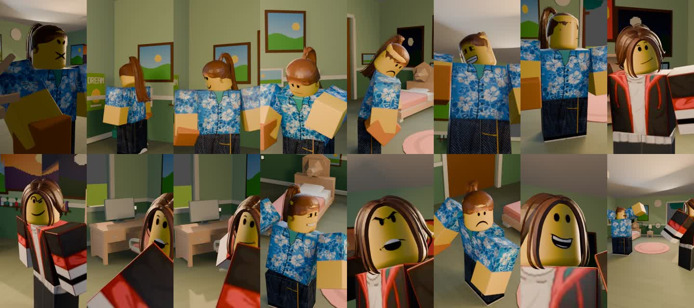
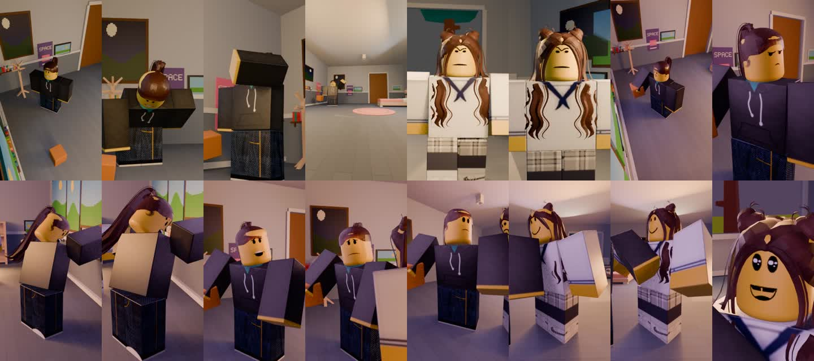
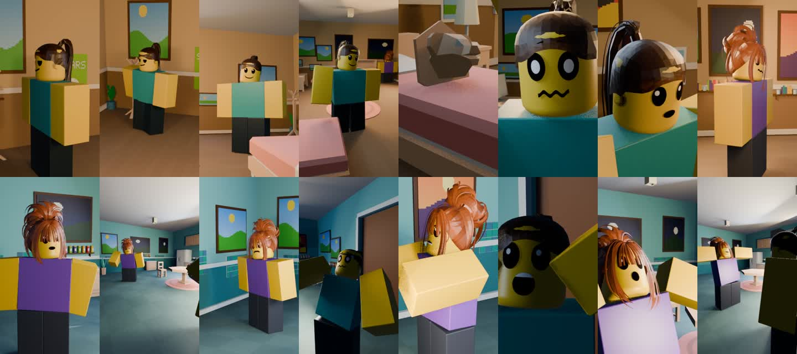
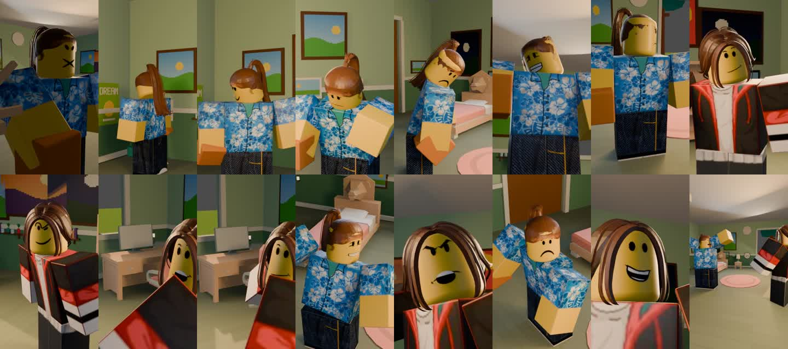
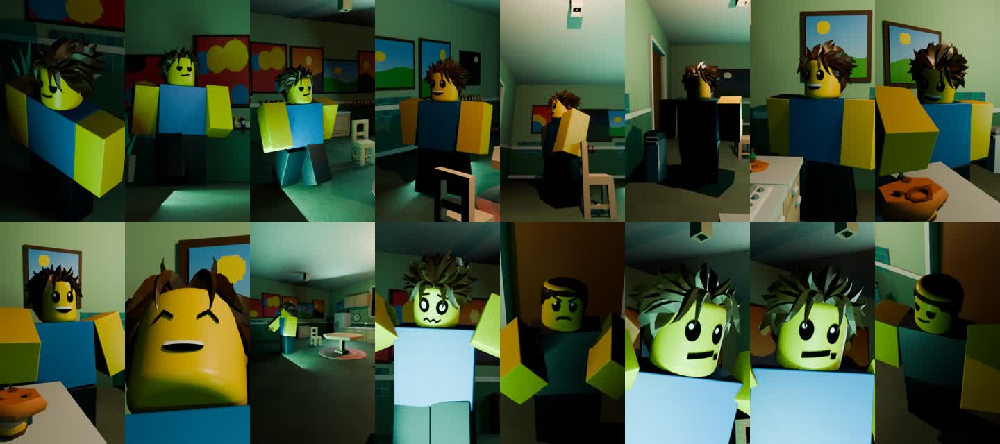
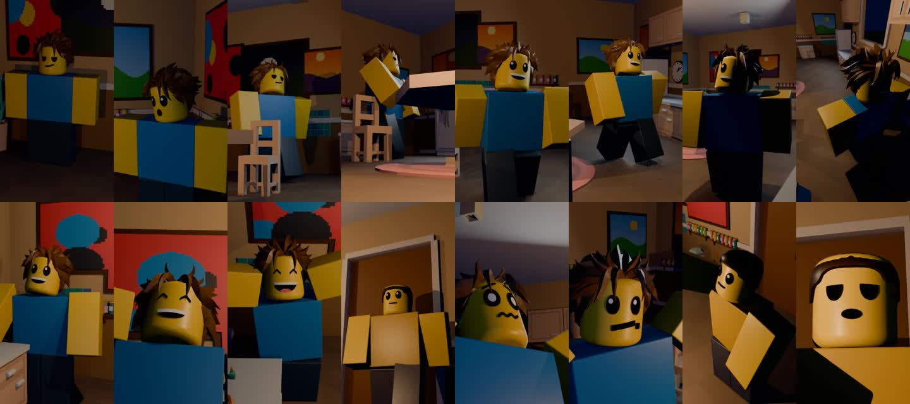

# Changelog

Every fix to the NoCodeHack Roblox Engine, newest first: what you saw, why it happened, what changed, and how it was tested.
Found a problem? Open an issue or comment on the video, it lands here.

## 1.14.0 · 2026-11-17

### Fixed
- A malformed flight in a fight is rejected as a whole, so it can no longer leave a power-up or aura half-animated.
- Fight effects have a time limit: extreme or invalid durations are rejected with a clear message instead of freezing a build.
- A character knocked back while walking no longer straightens up mid-fall when the walk would have continued.
- Seated or lying characters can be hit without losing their sitting or lying animation.
- A rejected beam deflection no longer leaves its charge ball behind, and a failed effect removes everything it created.
- Importing a Roblox model no longer fails on its final documentation step.

### Changed
- Beam settings (size, hand, colour, deflection) are checked up front instead of silently falling back.
- The story check now applies the same fight limits as the engine, including a scene's own frame rate.

### Testing
- The contributor's new fight test suite passes on Blender 5.2 (52 checks). On 13 fight and benchmark stories, every check
  and every reported problem is identical with and without the change, and a rendered fight scene is pixel-identical frame
  for frame. All 141 internal stories give the same story-check results.

Thanks to @Aztech-1729 for a second careful audit of the fight engine ([PR #2](https://github.com/nocodehack/nocodehack-roblox-engine/pull/2)).

## 1.13.0 · 2026-11-17

### Added
- Creatures and custom models in stories: a scene can include a dragon, a monster or any other model. It is placed and
  filmed by name, so characters can look at it, react to it and run from it, and the camera frames the whole creature.
- A built-in blocky dragon that flies in, flaps its wings, lands, hovers and roars. No download needed.
- Models from the Roblox Creator Store: when a story needs something the library does not have, Claude searches the
  Creator Store through Roblox Studio, imports a fitting free model once and keeps it for later stories.
- Example story: a dragon lands in a park and the kids run.

### Changed
- Claude asks to reopen Roblox Studio whenever it needs new assets (a model, a missing hair, new items after an update),
  waits until it is open, and says when it can be closed again. If Studio is not available, it uses a built-in option and
  says so.
- A story that calls for an animal or a creature now shows it on screen instead of writing around it.
- Shots of a creature size the frame to the whole creature instead of to a person.

### Documentation
- The README and setup instructions explain when Roblox Studio is needed.

### Testing
- The dragon example was built and checked frame by frame. A Roblox model already on disk was placed and moved as a
  creature. A story that asks for a model missing from the PC is flagged before the build. All 63 internal test stories
  pass the story check.

Thanks to the viewers who asked about dragons and about keeping Studio open.

## 1.12.1 · 2026-11-17

### Fixed
- Setup no longer stops when Roblox refuses some animations. Part of the animation library comes from a third-party Creator
  Store pack that Roblox does not let every account load. The engine now lists the refused animations, completes setup, and
  uses a similar animation in their place in stories (for example, a wave instead of "agree").

### Added
- Gunplay: characters can draw and fire a pistol, with muzzle flash, tracer, recoil and gunshot sound.
- Optional blood and bruise effects.
- A pastel Miami-style street set with palm trees.

### Changed
- More natural turns: the head now leads the body.
- Punch combos no longer show an anime aura unless the story asks for one.
- Roblox yellow skin keeps its colour in bright daylight scenes.

### Documentation
- The README and setup instructions now state that Roblox Studio is only needed while the engine fetches assets from Roblox
  and can be closed afterwards.

### Testing
- Simulated a restricted account by removing two animations: setup reported the library as complete and the substitutes
  played in a test story. All 63 internal test stories pass the story check.

Thanks to the community member who reported the animation issue on YouTube.

## 1.11.1 · 2026-11-15 · Reliability fixes from a community audit (thanks @Aztech-1729)

Our first outside contribution: [@Aztech-1729](https://github.com/Aztech-1729) audited the engine line by line
([PR #1](https://github.com/nocodehack/nocodehack-roblox-engine/pull/1)). We reviewed every change, tested it, kept what
helps, fixed three issues on top, and merged.

**The big one: format overlays were broken.** The "choice" and "time card" formats drew large white boxes over the video
because the subtitle style tags were being turned into invisible control characters. Now they look as designed:

**Also fixed:** a crash in very small rooms (no camera position fit), crashes on story typos (an unknown walk target or shot
subject, a prop held by someone not in the scene, `desk:9`, `speed: 0`, an empty walk), long walks that ran into the next
action, sound effects that could drift if the build's notes changed wording, a clear error when ffmpeg is missing, safer
cloud-render and download tools, and more (full list in the PR).

**Kept out:** a change that would have altered the desert look of the anime showcase, one creator-tool tweak, and a billing
filter that only works for one currency (reasons in the PR).

**Tested:** every story passes the checks; on 9 benchmark stories all 22 scenes pass, 6 are unchanged and 3 improved or
stayed equal; overlays checked on real renders before and after.

## 1.11.0 · 2026-11-15 · Claude now catches the same shot repeated

**What you saw:** one character shown again and again in the same chest-up shot, so the Short felt like one long take.

**What changed:** the story check warns when a character is the focus of three or more shots in a scene, all the same size, and
suggests the fix: a close-up for the emotional beat, a full shot to re-place them in the room.

**Tested:** the warning fires on exactly the test stories critic agents had called repetitive, and on none of the shipped
examples.

## 1.10.1 · 2026-11-15 · Opening shots keep faces readable

**What you saw:** after 1.9.0 some scenes opened on a very wide shot where the characters were tiny and their faces could not
be read on a phone.

**What changed:** the directing guide now opens a scene with one or two characters on a `full` shot; `wide` is kept for three
or more people or a big action (a chase, a fall).

**Tested:** the same idea written by a fresh AI agent with the previous and the new guide (also using the new box shake), judged
by two critic agents next to two reference Shorts: camera 3 -> 4, story 2 -> 3.5. The new story had zero framing problems.

## 1.10.0 · 2026-11-15 · Props can shake: a hidden pet you can actually "see"

**What you saw:** stories about a hidden pet where nothing showed the pet: the engine has no animal models, so the box just
sat there and the story did not read.

**What changed:** props get a `shake` key: a list of seconds where the prop jolts for half a second (hops and twists, then
settles exactly where it was). A box with a puppy inside, a buzzing phone, a rattling cupboard. The skill now writes hidden
animals this way: the box on the floor shakes, an insert shows it, then the character reacts. (It is skipped on props a
character is holding, so it never fights the hands.)

**Tested:** a test scene shows the box still, then jolting twice, then back at rest; normal stories build exactly as before.

## 1.9.0 · 2026-11-15 · Every scene now shows where we are

**What you saw:** Shorts made almost only of chest-up shots: you never saw the room or who stands where.

**Why:** the skill's own fix table told Claude to switch off the engine's establishing shot and open on a medium whenever a
head was cropped, and to switch off the automatic camera angles in every scene.

**What changed:**
- The directing guide: every new location opens with a ~1 s `full` or `wide` that shows the room and who stands where.
- The fix table: a cropped head now means *that shot one size wider*; the establishing shot is switched off only for a
  scene that continues in the same place; the automatic high/low angles are switched off only in the scene where faces
  are hidden.

**Tested:** the same story idea written by a fresh AI agent before and after, judged by two critic agents next to two
reference Shorts: camera 3 -> 4, story 3 -> 3.5. Both picked the new version (room established, more shot types).

| Before | After |
|---|---|
|  |  |

## 1.8.0 · 2026-11-15 · The engine now spots arms blocking the shot

**What you saw:** shots where a gesturing arm or shoulder covered a big part of the frame, and nothing warned about it.

**Why:** the engine's body check counted the character's own torso too, so almost every medium shot scored the same and real
arm slabs did not stand out.

**What changed:** a new measurement counts only arms, legs and other characters in front of the camera (never the subject's
own torso). When it is high, the `LOOK` line says `arm across the frame`, and the skill's fix table tells Claude what to do:
a calmer pose, `gesture: false` on that line, or turning the character side-on. Information only: it never changes a render.

**Tested:** on 72 shots the four highest scores were exactly the arm-slab shots a critic had pointed out; on 5 test stories
all checks pass and the framing is unchanged.

## 1.7.1 · 2026-11-15 · Listeners react after the line starts, not before

**What you saw:** in conversations, the listening character turned to the speaker a moment *before* the speaker said
anything, as if they could read minds. Small, but it makes acting feel mechanical.

**Why:** the automatic "listener looks at the speaker" turn was timed to land exactly on the first word, so it started early.

**What changed:** the listener's head turn now starts 0.1 s after the line begins and lands at about 0.35 s, the short
thinking delay animators use for a natural reaction. Most visible in two-character shots and reaction cuts.

**Tested:** 7 test stories: all checks pass, and shots and framing are unchanged. Only the reaction timing moved.

## 1.7.0 · 2026-11-15 · A directing guide: structure, camera and acting timing

**What you saw:** stories that were flat: no build-up, stiff reactions, characters that are hard to tell apart, shots that
don't serve the moment.

**Why:** the skill told Claude *what* the engine can do, not *how to direct* a Short with it.

**What changed:** a new `DIRECTING.md` that Claude reads before writing every story: 23 rules, each mapped to the story keys
that do it. They were distilled in our own words from studying classic books on shot grammar, visual structure and
animation timing, then tested on this engine. Some examples:
- plan the intensity curve (hook, build, climax, payoff) before the first beat;
- casting must read at a glance (a girl gets longer hair, leads never share hair or shirt colour);
- shot size follows pressure; open scenes on a face, not a back;
- listeners react 0.1-0.25 s late, faces change before the body moves, hold a key pose 0.4-0.5 s.

**Tested:** the same idea ("a girl hides her new puppy from her mom") written by a fresh AI agent without and with the guide,
judged by three independent critic agents next to two reference Shorts from a top Roblox creator, on one 0-10 scale:

| Lens | Reference | Before | After |
|---|---|---|---|
| Acting | 8-8.5 | 4 | **5.5** |
| Camera | 8 | 3 | **4** |
| Story | 6-8 | 2 | **3** |

All three picked the new version. There is still a gap to the reference (establishing shots, stiffer bodies), which the
next releases work on.

| Before | After |
|---|---|
|  |  |

## 1.6.0 · 2026-11-15 · Claude now catches characters that look alike

**What you saw:** two characters you could not tell apart: both in near-black clothes (dark twins on screen), or the same
hair on both.

**Why:** a Short has no name tags, so the viewer tells characters apart only by hair and clothes. Nothing checked that.

**What changed:** the story check (`story_lint`) now warns before anything renders when two characters wear the same
library hair, or shirts of nearly the same colour with the same hair, or are both dressed in near-black. For library
outfits it reads the actual front-of-torso colour of the Roblox shirt. Matching uniforms are fine when the heads differ
(Goku and Krillin's orange gi still pass).

**Tested:** 17 test and example stories: exactly one warning, on the test story whose leads were both in black; no false
alarms on any shipped example.

## 1.5.0 · 2026-11-15 · The engine now tells Claude which shots read badly

**What you saw:** shots where a character's eyes were hidden under their fringe, a head cut off at the top, or the back of a
head instead of a face, which Claude missed when looking at the small draft thumbnails.

**Why:** the engine already measured all of this for every shot, but only used it to pick camera angles; Claude never saw
the numbers.

**What changed:** after each scene the engine prints a `LOOK` line, for example
`LOOK S04 eyes hidden; S06 head cropped/eyes hidden`. The skill's draft fix loop reads it and fixes each listed shot
(another hair, a wider size, turning the character). It is information only: it never blocks a build or changes a render.

**Tested:** on the fresh-user test story, the `LOOK` line listed exactly the three shots where the mom's eyes were hidden on
the draft sheet, plus the cropped heads and backs of heads; checks and renders unchanged.

## 1.4.2 · 2026-11-15 · Lessons from a fresh test run

A brand-new Claude, with only this skill, made a Short ("a girl hides her new puppy from her mom"). Gates passed first
time and the camera had real variety. It also hit five rough spots, now covered in the skill:
- **Back of a head:** turning the character to the camera first, then `front: true`. `front` alone on someone walking away
  failed the face check.
- **Animals:** the engine has no animal models. Claude now tells you and writes around it (the pet hidden in a box, heard
  but not seen, or a toy) instead of passing a random prop off as a puppy.
- **Draft sheet after partial rebuilds:** one full draft before judging the whole sheet; a fix that breaks a check is undone.
- **Fringe hairs that cover the eyes** are listed, so Claude swaps them when faces disappear.
- **Entrances:** start in a doorway or at the room edge, then walk in.

## 1.4.1 · 2026-11-15 · "Washed-out" drafts explained

**What you saw:** in the draft, night close-ups looked blown out: grey hair, pale faces.

**Why:** the draft is a fast preview with approximate light. The same frame in the real render looks right (brown hair,
normal face). Claude was judging, and showing you, the draft as if it were final.

**What changed:** the skill now tells Claude never to judge light from the draft. It renders one real frame of the
scene (about a minute) before changing colours or light, and tells you the draft is a rough preview.

**Tested:** the washed-out close-up from a test story rendered at `mid`: correct colours in 14 seconds.

## 1.4.0 · 2026-11-15 · Anime fights get the real flame aura

**What you saw:** in Dragon Ball style fights the power-up aura was a plain glowing ball, not the flames in the README clips.

**Why:** the flame sprites are Roblox Creator Store images, so they are not stored in this repo, and the setup never
downloaded them. Without them the engine falls back to simple glow spheres.

**What changed:** `python tools/fetch_library.py public` now also downloads the 14 aura sprites from Roblox's public
image service (no Roblox Studio needed), and `status` shows an `aura` line. When the engine updates, Claude re-runs any
missing setup step by itself.

**Tested:** clean install without the sprites: 14/14 downloaded, all pixel-identical to the ones used for the README clips.

## 1.3.0 · 2026-11-15 · More camera moments: Claude writes richer stories and fixes its own draft

**What you saw:** flat Shorts: few shots, characters standing still, a dark silhouette, odd framing, "no camera moments".

**Why:** the engine's camera cuts on actions: reactions, entrances, props, big emotions. A first story written from the
skill had 9 beats and 7 shots for two scenes, so the camera had little to cut to. The skill also only said "look at the
draft", so Claude saw problems and stopped there.

**What changed (SKILL.md):**
- "Make it look good": a beat every 1-1.5 s, a reaction to every line, an entrance, a prop the hero looks at or grabs (the
  engine adds a close-up on it), one big emotion beat per scene (the engine adds an extreme close-up), 4-6 faces per
  character, shirts that contrast with the yellow skin, readable night colours.
- "Draft fix loop": Claude lists what is wrong in the draft frames and fixes it with the engine's own keys (opening
  framing, faces under hair, silhouettes, backs of heads, fights from behind), up to 3 rounds, and tells you what it fixed.

**Tested:** the same idea ("kid sneaks cookies at night, dad catches him") written before and after the rules.
Before: 9 beats, 15 camera shots. After: 15 beats, 20 camera shots, an entrance through the door, readable dad, 8+ faces.

| Before | After |
|---|---|
|  |  |

## 1.2.0 · 2026-11-15 · Claude tells you when a new version is out

**What you saw:** nothing. Fixes were published on GitHub, but the skill on your PC stayed old and nobody told you.

**Why:** the plugin on your PC only updates when you update it, and the skill never checked for a newer version.

**What changed:** at the start of every session the skill reads one tiny public file from this repo (the version number;
nothing about you is sent). If a newer version is out, Claude tells you once, with the update command and a link to this
changelog. Offline or GitHub down: it skips the check and carries on.

**Tested:** older copy -> `UPDATE 1.1.0 (you have 1.0.0)`; same version -> `OK 1.1.0`; no network -> `OK (no check)`.

## 1.1.0 · 2026-11-14 · Hair setup now gets all 49 Roblox hairs (was 14)

**What you saw:** after the Roblox Studio setup step, many hairs were missing (characters fell back to plain hair), and
some characters wore the wrong hair.

**Why:** the setup grabs each hair from Roblox Studio's download cache. It only looked at files written in the 1-2 seconds
while each hair loaded, so a hair Studio had already downloaded before was missed. In that time slot it also took the
biggest mesh it saw, which could belong to another hair (a Super Saiyan hair got a 35,826-vertex mesh instead of its own
5,607), and the first texture it saw, sometimes a blurry 64 px copy.

**What changed:**
- The hair step now searches Studio's whole cache. Each mesh is recognised by its exact vertex and triangle count, each
  texture by a tiny 16x16 fingerprint and its original size (stored as numbers in the manifest; no Roblox files ship).
- A mesh from the time slot is only accepted if its shape matches; a wrong texture is replaced.
- If the cache only holds a low-res texture, the public Roblox thumbnail is used instead.
- `hair_qa.py` and `outfit_qa.py` no longer crash on a fresh install.
- Running the step twice is now safe.

**Tested:** clean install, real setup steps through Roblox Studio: 49/49 hairs. All 49 meshes have the same vertices as
the reference library, 46/49 textures are pixel-identical (2 differ by about 1/255, one is 700 px instead of 1000 px),
and all 49 sit correctly on the head in the hair check sheet.

- Already installed? The hair step now repairs old installs: a hair with the wrong mesh is detected (vertex count) and
  replaced. Tested on a simulated old install: 2 wrong meshes replaced, 10 missing hairs restored, 49/49.
- The skill now updates your project's engine copy by itself when a new version is out (your stories, fetched Roblox
  files and `.env` are kept), and links this changelog.

**How to get it:** run `/plugin marketplace update nocodehack-roblox-engine`, then use the skill as usual. Claude updates
your engine and asks you to open Roblox Studio for the hair step again (about 2 minutes).
